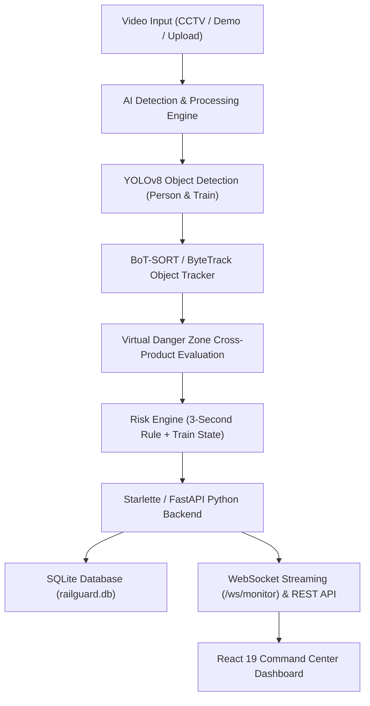

# RailGuard AI
**Intelligent Railway Platform Safety & Threat Monitoring System**

[](LICENSE)
[](https://www.python.org/)
[](https://react.dev/)
[](https://docs.ultralytics.com/)
[](https://tailwindcss.com/)

---

## 1. Overview

**RailGuard AI** is an automated computer-vision safety surveillance system designed for railway station platforms. Using state-of-the-art object detection (**YOLOv8**) and multi-object tracking (**BoT-SORT / ByteTrack**), RailGuard AI monitors passenger positions relative to a calibrated virtual danger zone (safety line) and evaluates risks in real time against the train's dynamic state (*Approaching*, *Stopped*, or *Departing*).

When a passenger breaches the danger zone threshold (the **3-Second Rule**) during train movement, the system immediately raises visual alerts, triggers real-time telemetry streaming over WebSockets, and logs safety incidents to the database.

---

## 2. Key Features

- **Live Platform Surveillance**: Real-time visual monitoring feed displaying passenger bounding boxes, foot positions, danger boundary, and tracker IDs.
- **Train Motion State Detection**: Automatically determines train states (`APPROACHING`, `STOPPED`, `DEPARTING`) using horizontal centroid delta tracking.
- **Dynamic 3-Second Rule Engine**:
  - `Train APPROACHING + >= 3s in danger zone`: **CRITICAL** Alert
  - `Train DEPARTING + >= 3s in danger zone`: **HIGH** Alert
  - `Train STOPPED`: Normal boarding/disembarking monitoring with transit tracking
- **Multi-Object Tracking**: Persistent ID assignment using BoT-SORT / ByteTrack.
- **Interactive Command Center**: Modern, dark-themed responsive UI built with React 19, Lucide Icons, and Tailwind CSS.
- **Incident History & Evidence**: Detailed incident table with risk level filtering, search, and full audit logs.
- **Flexible Video Source**: Support for CCTV video uploads (`.mp4`), preloaded demo recordings, and automatic synthetic test video generation.

---

## 3. System Architecture



---

## 4. Technology Stack

- **Computer Vision & AI**: Ultralytics YOLOv8 Nano (`yolov8n.pt`), OpenCV, NumPy, BoT-SORT / ByteTrack
- **Backend**: Python 3, Starlette / FastAPI, SQLite, Uvicorn, WebSockets
- **Frontend**: React 19, Vite, Tailwind CSS, Lucide React, Axios

---

## 5. Model Weights & Large Files

- **YOLOv8 Nano Model (`yolov8n.pt`)**: The lightweight weights file (~6.2 MB) is bundled in the repository root. If downloading manually or refreshing:
  ```bash
  # Download official YOLOv8n weights
  curl -o yolov8n.pt -L https://github.com/ultralytics/assets/releases/download/v8.2.0/yolov8n.pt
  ```
- **Sample Test Videos (`data/input/`)**: Sample MP4 video files are located in `data/input/`. If no video is present, run `python scripts/generate_dummy_video.py` to generate an automated synthetic benchmark video.

---

## 6. Installation & Setup

### Prerequisites
- **Python 3.10+** (Python 3.11, 3.12, 3.13 supported)
- **Node.js 18+** & npm

---

### Step 1: Clone the Repository
```bash
git clone https://github.com/SHREYASHUKLA2007/Railguard-AI.git
cd Railguard-AI
```

---

### Step 2: Backend Setup (Python)

1. **Create and activate a virtual environment**:
   - **Windows**:
     ```powershell
     python -m venv .venv
     .\.venv\Scripts\activate
     ```
   - **Linux / macOS**:
     ```bash
     python3 -m venv .venv
     source .venv/bin/activate
     ```

2. **Install Python dependencies**:
   ```bash
   pip install -r requirements.txt
   ```

3. **Verify AI & Model Setup**:
   ```bash
   python scripts/test_ai.py
   ```

---

### Step 3: Frontend Setup (React + Vite)

1. **Navigate to the frontend directory**:
   ```bash
   cd frontend
   ```

2. **Install npm packages**:
   ```bash
   npm install
   ```

3. **Build or develop**:
   - Development server:
     ```bash
     npm run dev
     ```
   - Production build:
     ```bash
     npm run build
     ```

---

## 7. Running RailGuard AI

### Option A: Complete Integrated Server (Recommended)

1. Build the frontend (from `frontend/` directory):
   ```bash
   npm run build
   ```
2. Start the backend server from the project root:
   ```bash
   python -m uvicorn backend.app.main:app --host 0.0.0.0 --port 8000
   ```
   or simply:
   ```bash
   python backend/app/main.py
   ```
3. Open your browser at **http://localhost:8000**. The Starlette backend serves both the API and the compiled React command center.

---

### Option B: Concurrent Development Mode

1. **Backend Terminal** (port 8000):
   ```bash
   uvicorn backend.app.main:app --host 0.0.0.0 --port 8000 --reload
   ```
2. **Frontend Terminal** (port 5173):
   ```bash
   cd frontend
   npm run dev
   ```
3. Open **http://localhost:5173**.

---

## 8. Dashboard Navigation & Usage

- **Overview**: Live CCTV platform stream, active threat indicators, summary statistics, and recent safety incident logs.
- **Live Monitoring**: Dedicated full-screen camera view with video switcher, video upload facility, live risk level badge, and real-time bounding boxes.
- **Incidents**: Searchable and filterable database table of all recorded safety infractions, risk levels (`CRITICAL`, `HIGH`, `MEDIUM`, `LOW`), durations, and timestamps.
- **Interactive Modals**: Click on any of the summary cards (Train Status, Safe Passengers, Danger Zone Violations, Critical Alerts) to inspect telemetry breakdowns.

---

## 9. API Reference

| Endpoint | Method | Description |
|---|---|---|
| `/api/health` | `GET` | Health check endpoint |
| `/api/status` | `GET` | Current system and monitoring status |
| `/api/monitor/start` | `POST` | Start CV detection and video loop |
| `/api/monitor/stop` | `POST` | Stop active video monitoring |
| `/api/monitor/frame` | `GET` | Polling fallback for frame & telemetry |
| `/api/incidents` | `GET` | Query incidents (supports `?risk=`, `?search=`, `?limit=`) |
| `/api/incidents/seed` | `POST` | Seed sample incidents for demonstration |
| `/api/videos` | `GET` | List available demo & uploaded videos |
| `/api/video/select` | `POST` | Select active video input file |
| `/api/video/upload` | `POST` | Upload custom CCTV MP4 video file |
| `/ws/monitor` | `WebSocket` | Real-time bidirectional telemetry & frame stream |

---

## 10. Live Deployments & Repository

- **Live Frontend (Vercel)**: [https://frontend-iota-woad-56.vercel.app](https://frontend-iota-woad-56.vercel.app)
- **Production Backend (Render)**: [https://railguard-ai-backend.onrender.com](https://railguard-ai-backend.onrender.com)
- **GitHub Repository**: [https://github.com/SHREYASHUKLA2007/Railguard-AI](https://github.com/SHREYASHUKLA2007/Railguard-AI)

---

## 11. Production Deployment Guide

### A. Frontend Deployment (Vercel)
- **Framework**: Vite / React 19
- **Root Directory**: `frontend`
- **Build Command**: `npm run build`
- **Output Directory**: `dist`
- **Environment Variables**:
  - `VITE_BACKEND_URL`: `https://railguard-ai-backend.onrender.com`

### B. Backend Deployment (Render)
- **Runtime**: Python 3.11.9
- **Build Command**: `pip install --upgrade pip && pip install torch torchvision --index-url https://download.pytorch.org/whl/cpu && pip install -r requirements.txt`
- **Start Command**: `uvicorn backend.app.main:app --host 0.0.0.0 --port $PORT`
- **Environment Variables**:
  - `PYTHON_VERSION`: `3.11.9`
  - `CORS_ORIGINS`: `https://frontend-iota-woad-56.vercel.app,https://frontend-shreya-shuklas-projects-8a138f10.vercel.app,https://railguard-ai-liard.vercel.app`

